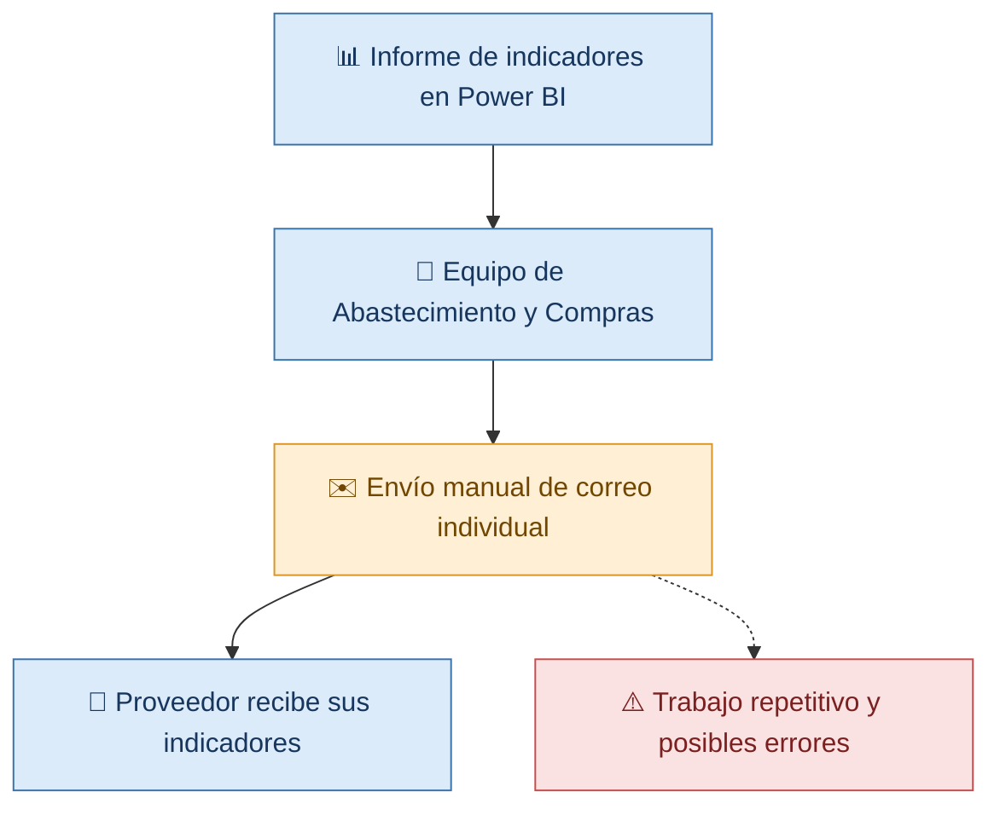
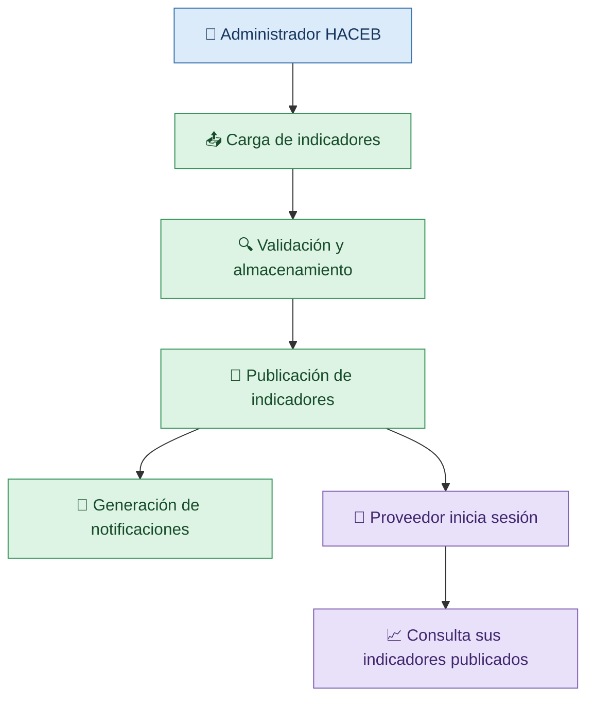

# Proceso actual de entrega de indicadores HACEB

## 1. Objetivo

Documentar el proceso de entrega de indicadores mensuales a los proveedores de HACEB, identificar las dificultades del proceso actual y explicar cómo la solución propuesta busca facilitar la consulta de los indicadores mediante un portal web.

## 2. Solución propuesta

De acuerdo con la documentación técnica del proyecto, se propone una plataforma web para que los proveedores de HACEB puedan consultar sus propios indicadores mensuales y revisar información de periodos anteriores.

La solución contempla dos tipos de usuarios:

- **Administrador de HACEB:** puede gestionar la información de los proveedores, cargar indicadores mensuales y publicar los resultados.
- **Proveedor:** puede consultar sus propios indicadores publicados y revisar los periodos disponibles.

El sistema contempla un mecanismo de notificación por correo electrónico cuando se publican nuevos indicadores. Además, el acceso a la información debe estar controlado para evitar que un proveedor consulte los datos de otro.

**Nota:** esta sección describe el funcionamiento previsto según la documentación técnica del proyecto. No confirma que todas estas funcionalidades estén implementadas o funcionando actualmente.

## 3. Proceso actual

Según la ficha del reto empresarial de Industrias Haceb, la entrega de indicadores a los proveedores nacionales se realiza mensualmente mediante el envío manual de un correo electrónico individual a cada proveedor con sus indicadores.

En este proceso participa el equipo de Abastecimiento y Compras, específicamente durante la comunicación de los indicadores a los proveedores nacionales.

### 3.1. Dificultades del proceso actual

La ficha del reto identifica las siguientes dificultades:

- El envío manual requiere trabajo administrativo del equipo.
- Cada proveedor necesita una intervención individual para recibir sus indicadores.
- El proceso demanda tiempo que podría dedicarse a actividades de análisis.
- La intervención manual puede generar errores humanos en la información enviada.

Estas dificultades motivan la búsqueda de una solución que automatice el proceso y reduzca la carga operativa del equipo.

**Fuente:** Ficha del reto empresarial «Automatización del envío de indicadores a proveedores nacionales», página 1.

## 4. Diagramas de los procesos

### 4.1. Proceso actual

El proceso actual descrito en la ficha del reto empresarial se representa de la siguiente manera:

Este proceso requiere intervención individual para enviar los indicadores a los proveedores y puede generar errores humanos.

### 4.2. Proceso propuesto

Según la documentación técnica del proyecto, el proceso propuesto se representa de la siguiente manera:

El proceso propuesto busca facilitar la consulta de los indicadores mediante un portal web. El diagrama representa el funcionamiento previsto en la documentación técnica, no confirma que todas las funcionalidades estén implementadas.

## 5. Fuentes de información y datos pendientes de verificación

### 5.1. Fuente consultada

La ficha del reto empresarial «Automatización del envío de indicadores a proveedores nacionales» indica que la información de los indicadores está disponible en un informe de Power BI. También menciona información sobre una automatización anterior realizada desde Power BI.

### 5.2. Archivos de datos pendientes

La tarea DOC-01.1 solicita identificar los archivos `proveedores.csv`, `ordenes.csv` e `indicadores_mensuales.csv`. Durante la revisión de la copia local del repositorio no se han localizado estos archivos.

Por lo tanto, queda pendiente confirmar con el equipo del proyecto dónde se encuentra el kit de datos y revisar el contenido de los archivos antes de documentar su estructura y uso.

### 5.3. Información por confirmar

- Ubicación y disponibilidad de los tres archivos CSV.
- Columnas y contenido de cada archivo.
- Forma en que se utilizan los datos para preparar los indicadores que se envían a los proveedores.
- Restricciones específicas para el uso de la información.

**Fuente consultada:** ficha del reto empresarial de Industrias Haceb, sección «Recursos para trabajar», página 1, y sección «Información y condiciones de uso», página 2.